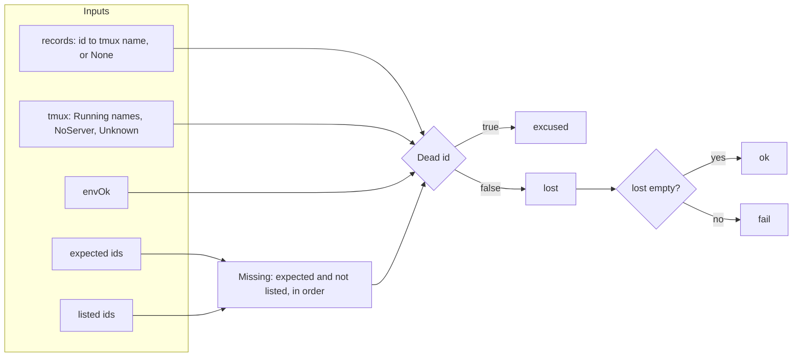

# Formal model of the health check's session decision

`SessionSurvival.dfy` models `decideSessions` in `../session-survival.mjs`: when the new colour does not list a session the live colour lists, the deploy health check passes only if that session's tmux session is provably gone. The file proves five properties:

| Lemma | What it guarantees |
| --- | --- |
| `PassMeansListedOrDead` (S1) | A pass means every expected session is listed by the new colour or provably dead. |
| `RunningSessionLostFails` (S2) | A missing session whose tmux session still runs always fails the check and is named. |
| `FailClosedIsOldCheck` (S3) | With no environment, an unreadable record file or a tmux error, the check is exactly the old "every expected id is listed". |
| `OldPassStillPasses` (S4) | Whatever the old check passed, the new one passes, excusing nothing. |
| `ReportIsExact` (S5) | The excused and missing lists split the missing ids exactly, by provable deadness. |



`Dead(id)` holds only when `envOk`, the records are readable and hold the id, tmux answered, and either no server runs or the recorded name is not listed. Any doubt makes the id lost, which is S3.

`oracle/` is the model built to Python by `build-oracle.sh`. It is generated code, including Dafny's MIT-licensed Python runtime (`_dafny/`): never edit it. `drt_oracle.py` drives it, and `test/session-survival.drt.test.ts` compares the shipped JavaScript with it on random inputs (differential random testing), in the deploy gate.

What the model does not cover, and the DRT's second tier tests end to end instead: reading `mux-sessions.json`, classifying tmux's answer, and the environment variables.

```sh
DAFNY=/path/to/dafny deploy/model/build-oracle.sh          # verify, rebuild oracle/
DAFNY=/path/to/dafny deploy/model/build-oracle.sh --check  # verify, fail if oracle/ is stale
```

Change the model, the JavaScript and the oracle together.
