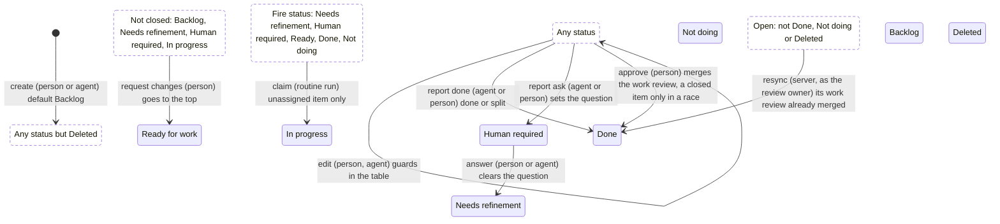
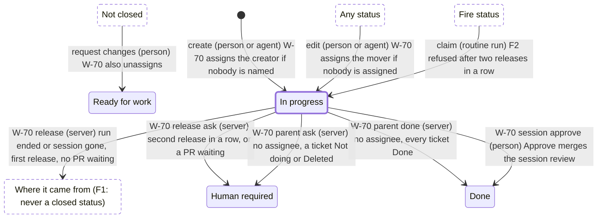

# Intent: W-70 In progress always has a live owner

**Status:** Draft (spec for W-70, under `intent/2026-11-18-spec-first-lifecycle.md`; revision 4)

## Problem statement

The Work board can say an item is In progress when nobody is working on it. On 2026-11-18 four items sat In progress, and none of them was moving:

- **W-61.** R-2 claimed it at 19:02:47 and started a run. A deploy switched colours two seconds later. The session was created by build `9c3641fa` (pid 2063570) and restored by build `ceabe5b8` (pid 2099175) at 19:02:48.9. So the run's prompt was never delivered: its message is `failed`, `deliveredAt: null`, and the session shows 0 tokens. The task read `failed`, but the item stayed In progress and assigned to that session for two hours. The claim is written once, when the run starts (`claim()` in `src/web/routine-runner.ts`). Only the agent's own `report` ever releases it.
- **W-56.** An interactive session created it straight into In progress, with nobody assigned. Its PR #69 was named only in the description, so `pr` was never set. PR #69 merged on 2026-11-17 at 21:14 through its session review, and nothing closed the item.
- **W-66.** Request changes moved it to Ready for work but left its finished builder assigned. R-2 picks up only unassigned items, so nothing took the revision for 36 minutes, until another session claimed it by hand.
- **W-22.** A parent item, In progress and unassigned while its tickets move. Today that is correct only because someone set it by hand. Nothing moves it once its tickets close.

These have one cause. In progress is a bare status, and nothing ties it to someone doing the work. "An agent is on this" and "someone once said an agent was on this" look the same on the board.

## Outcomes

1. An item is In progress only while it has an owner: a person, a live session, or tickets of its own that are still open.
2. When a routine run that holds an item ends without reporting, the item goes back on its own within one routine tick (30 s). It never needs a person to notice it.
3. A release that keeps failing stops and asks Harry. It does not spin up a new run every 30 seconds.
4. Request changes hands the revision to the pickup routine.
5. A parent item closes when its tickets are all done.
6. Approving a session review closes the In progress items that session is linked to.

## Constraints

- **Self-building rule 5.** `work.json` stays readable by the release before this one. No new stored status and no new item key. The release count is read from history, not stored.
- **Rule 6, live colour only.** Every release is a write through `changeWork()` under `mayAutomate()`.
- **The 8 GiB host.** No new timer and no new process. The release runs inside the routine runner's existing 30-second tick and reads the task list that tick already fetches.
- **Fail closed.** An owner whose state cannot be read counts as live. A task list that cannot be read, a session map not yet restored after boot (before `markRestorationComplete()`, `server.ts:4543`), or a pane whose exit state is unknown never releases anything.
- **Rules live in `work.ts`.** The owner rule and the release decision are pure functions there. The runner supplies only the facts.
- **No id-branching** on a CLI id. Routine runs are recognised by `startedBy.kind === 'routine'`, as the runner already does.
- **`canvas_capabilities` is at its 60 KB cap.** Nothing is added to it. The `canvas_work` tool description changes one sentence.

## Data shape

```ts
/** Who keeps an item In progress, as the server sees it at one moment. */
type Owner =
  | { kind: 'person' }                                     // assignee {kind:'person'}
  | { kind: 'run'; runId: string; taskId: string; state: TaskState }   // assignee is a routine run's session
  | { kind: 'session'; sessionId: string; state: 'live' | 'exited' | 'gone' | 'unknown' }
  | { kind: 'tickets'; open: number[] }                    // no assignee; items createdFrom it that are not closed
  | { kind: 'none' };

/** The pure decision. `ownerOf` is the runner's facts; the result is the one write to make, or null. */
function releaseFor(item: WorkItem, file: WorkFile, ownerOf: (item: WorkItem) => Owner): Release | null;
type Release =
  | { to: WorkStatus; reason: string }                     // back where it came from
  | { to: 'human-required'; question: string }             // second release in a row, or an open PR
  | { to: 'done'; reason: string };                        // a parent whose tickets are all Done
```

`Owner` is derived every tick and never stored. Its liveness facts come from the same places the task list already reads them: `deriveTaskState()` for a run, and `session ? (paneExit ? 'exited' : 'live') : 'gone'` for a session (`canvas-conversation-routes.ts:125`).

## Lifecycle

How a Work item moves between statuses: first today's code, then what W-70 adds. Every edge below comes from the code on `origin/master` ce40f9af, and each is cited in the table under the diagrams. The model in [`2026-11-18-w70-lifecycle.dfy`](2026-11-18-w70-lifecycle.dfy) is checked against both diagrams (see "How this was checked").

Dashed boxes are groups. An arrow from or to a group stands for one arrow per status in it, and a move to the same status is not a move. Each label reads *path (who) guard*.

**Today.**



**After W-70.** Only the edges W-70 adds or changes are drawn. Arrows labelled `W-70` are new. The others already exist and W-70 changes what they do. The diagram and the model include the fixes proposed for F1 and F2 (see "Verification findings").



| Group box | Statuses |
| --- | --- |
| Any status | all eight |
| Any status but Deleted | all but Deleted |
| Not closed | Backlog, Needs refinement, Human required, In progress (Ready is already there) |
| Fire status | Needs refinement, Human required, Ready, Done, Not doing |
| Open | Backlog, Needs refinement, Human required, Ready, In progress |
| Where it came from | Backlog, Needs refinement, Human required or Ready: the status in the newest `Moved from <A> to In progress` line. Created into In progress, or (F1) came from a closed status: Needs refinement |

| Path | Who | Edges | Guards | Code (`origin/master` ce40f9af) |
| --- | --- | --- | --- | --- |
| create | person or agent | into any status but Deleted | default Backlog | `work.ts:364`, `createWork` `work.ts:568` |
| edit | person or agent | any status to any other | an agent leaves Backlog or Deleted only when it quotes the person (deleting a Backlog item is not that move); an agent must say why it deletes; nothing enters Ready with an open question | `updateWork` `work.ts:613`, guards `work.ts:489`, `:642`, `:652`, move `:657` |
| answer | person or agent | Human required to Needs refinement | marking the question answered with no status | `work.ts:636` |
| report done, split | agent (or person) | any status to Done | the Backlog and Deleted guard | `reportWork` `work.ts:730`, `:746-749`, `:762` |
| report ask | agent (or person) | any status to Human required | the same guard | `work.ts:746`, `:802` |
| claim | routine run, written as the run's session | fire status to In progress | unassigned, still in the status it fired on; Backlog is refused by the guard, Deleted is never a fire status | `claim()` `routine-runner.ts:231`, `:241`, `:250`; `routines.ts:53`, `:95` |
| request changes | person (Reviews page) | not closed to Ready, at the top | closed items refused | `requestChangesOnWork` `work.ts:815`, `:823`, `:829`; `work-reviews.ts:218`; `review-routes.ts:830` |
| approve | person (Reviews page) | any status but Done to Done | the route refuses a closed item (`GONE`), but one closed during the merge's awaits still goes to Done | `approveWork` `work.ts:837`, `:849`; `work-reviews.ts:124`; `review-routes.ts:605-609`, `:636` |
| resync | server, written as the review's owner | open to Done | the item's work review already has a merge recorded; runs after every write to an item with a PR | `sync` `work-reviews.ts:136-137`, `follow` `:236-240` |
| W-70 release | server, routine tick | In progress back where it came from | owner not live (I2, I3), first release in a row, no PR waiting | I2, I3 |
| W-70 release ask | server | In progress to Human required | second release in a row (I4), or a PR with no changes pending (I2) | I2, I4 |
| W-70 parent done, parent ask | server | In progress to Done, or to Human required | no assignee and no open tickets (I7) | I7 |
| W-70 session approve | person | In progress to Done | Approve merges a review of a linked session (I8) | I8 |
| W-70 changes | | create and edit into In progress assign the mover (I1); request changes unassigns (I6); claim is refused after two releases in a row (F2) | | I1, I6, F2 |

**How this was checked.**

- *Formal: proved.* [`2026-11-18-w70-lifecycle.dfy`](2026-11-18-w70-lifecycle.dfy) models one item: its status, assignee, tickets, PR, question, where it came from, and the release and claim counts. Each write path above is a function in it. Dafny 4.9.1 verifies it with 45 proofs verified and 0 errors, and `dafny audit` reports 0 findings (no axioms, no `assume`). It proves:
  - *Edge sets.* The two diagrams' edges, expanded from the groups, equal the model's edges. Every status change any write makes is one of them, and each one has a concrete item that makes it (`DiagramTodayIsModel`, `DiagramW70IsModel`, `SoundToday`, `SoundW70`, `Complete`).
  - *I1.* With W-70, every write to an item leaves In progress with an owner (`I1_EveryWritePreservesOwner`). Today's code does not: an agent can create an unassigned In progress item, as W-56 was (`I1_TodayCounterexample`).
  - *Backlog and Deleted.* Only a person, or an agent quoting the person's instruction, moves an item out of them. Routines and the server never do (`OnlyAPersonLeavesBacklogOrDeleted`).
  - *I3.* No release fires on a person, an active run, a live or unknown session, or open tickets (`I3_LiveOwnersAreNeverReleased`).
  - *I4.* With no report and no person acting, a claimed item is released at most twice and claimed at most twice in a row. Every release after the first goes to Human required (`I4_AutonomousStepsPreserveBound`, `I4_LaterReleasesNeverRequeue`). This needs the F2 fix.
  - *I5.* The release run on its own output writes nothing (`I5_ReleaseIsIdempotent`).
  - *Findings.* Each finding below is a lemma that shows its counterexample (`F1_*`, `F2_*`, `F3_*`).
- *Mechanical: scripted.* The `.dfy` holds the diagrams' edges as two literal sets. A short script expands each Mermaid block above, group by group, and compares the result with those literals: today 99 edges, and 8 new in W-70. It matches. That script is not committed. It checks text against text, and the proof above takes over from there.
- *Semi-formal: searched, not proved.* A separate agent, running `crosscheck:trace-execution`, read every path that writes a Work item's status on `origin/master` and compared each one with the "Today" diagram. A search like this is not a proof. It found:
  - *Every edge family matches the code*, once two corrections were made: the *resync* path was missing (it is now in the diagram and the model), and *approve* reaches a closed item only in a race (its label now says so).
  - *No other writer.* `review-work.ts:58` only links sessions. Comments and attachments never change status. Decoding an old `work.json` (`work.ts:309-314`) maps stored statuses but is not a move.
  - *"A person" means a caller that did not say it is an agent.* A request without `X-Codeman-Parent-Session` is a person to these routes (`canvas-work-routes.ts:62-63`). The proofs about people rest on that.
  - *Today's code, not W-70.* (a) Resync re-closes a reopened item: a Done item whose work review merged goes back to Done after any write while it keeps its PR, written as the review's owner. (b) Done and Not doing have no guard for agents, unlike Backlog and Deleted. Neither one changes this spec.
- *What none of this covers.* The model is one item at a time. It does not prove the TypeScript does what the model says: that link is the citations above and the correspondence search. Timing, the 30-second tick, `expectedRevision` races and history text are outside it.

## Verification findings

The proofs found three gaps in the invariants as written. None changes a decision you made. Each proposed fix is a question for you, and no invariant has changed yet.

**F1. A release can re-delete or re-close an item.** I2 sends a released item back to whatever status it entered In progress from. That can be Deleted, Done or Not doing. A person restores a Deleted item straight into In progress for a session, and the session exits. The next tick moves the item back to Deleted, by the server, with no reason (`F1_ReleaseCanDelete`). A reopened Done item would go back to Done the same way.
*Proposed fix:* when it came from a closed status, a release goes to Needs refinement instead, as an item created into In progress already does. With the fix, a release never closes an item. Only the parent rule makes Done (`F1_FixedReleaseNeverCloses`).

**F2. I4 stops a storm only when the routine fires on Ready.** The second release goes to Human required. A routine whose trigger is Human required with `claim` (allowed today: any status but Deleted) would claim it again. Then a third run fails and a third release follows, every tick (`F2_StormWithoutFix`).
*Proposed fix:* `claim()` refuses an item released twice in a row. The count is the one I4 already reads from history. With it, the bound in I4 is proved for any routine.

**F3. A ticket closing breaks I1's wording.** I1 says no write leaves an item In progress with no owner. A parent's last ticket closing is a write to the ticket, and it leaves the parent In progress with no assignee and no open tickets until the next tick (`F3_TicketCloseBreaksI1`). I7 then moves the parent on that tick (`F3_NextTickRestoresI1`).
*Proposed fix:* reword I1 to "No write to an item leaves it In progress with no owner. A parent whose last ticket closes is moved by I7 on the next tick." The behaviour does not change.

## Invariants

## I1: InProgressHasAnOwner

No write leaves an item In progress with no assignee and no open tickets.
- A person who moves an unassigned item into In progress becomes its assignee (`{kind: 'person'}`).
- An agent who does so becomes the assignee (its own session).
- Unassigning an In progress item, or unlinking its assignee's session, is refused unless the same write moves it out of In progress.
- `create` into In progress follows the same rule.

- *Why:* W-56 was created into In progress with nobody assigned, so nothing could ever tell that its owner was gone.
- *Test:* for each write path (`create`, `update` status, `update` assignee null, `unlinkSessions` of the assignee, `report continue`) and each author kind, assert the stored item is never In progress with `assignee: null` and no open tickets.

## I2: EndedRunReleasesItsItem

An In progress item whose assignee is the session of a routine run, and whose task is not active (`failed`, `cancelled`, or `completed`), is released on the next tick.
- With no `pr`, or with `pr` and unaddressed `changes`, it returns to the status it entered In progress from (the newest `Moved from <A> to In progress` event). If that status is Ready for work, it goes to position 1.
- With a `pr` and no pending `changes`, it goes to Human required. The question names the run and the PR.
- The assignee is cleared and the run's session is unlinked. History reads `Released: run <runId> ended without a report`.

- *Why:* W-61. Moving it back into Ready fires R-2's trigger again, which is what moved W-61 on 2026-11-18 when it was done by hand.
- *Test:* an item claimed by a run whose task is each of `failed`, `cancelled`, `completed`. One tick later it is in Ready at position 1, unassigned, with the history line. Repeat with `pr` set, and it lands in Human required with `needs`.

## I3: LiveOwnersAreNeverReleased

The release never touches an item whose owner is:
- a person;
- a run whose task is `queued`, `running` or `waiting`;
- a session that is live or `unknown`;
- open tickets.

An interactive session is released only when it is `gone` or `exited`, never because it is idle.

- *Why:* a person can leave a conversation idle for hours and come back. A task a person started can sit `completed` between replies. Releasing those would put a second agent on work someone is doing.
- *Test:* each of those owners, held for many ticks, produces no write. A session the restore has not reached yet counts as `unknown`.

## I4: RepeatedReleaseAsks

The second release of an item with no `report` and no person's move between them sends it to Human required, with the question "W-n was released twice: runs <a> and <b> ended without reporting. Send it back to Ready for work when the cause is fixed."

- *Why:* if every run fails the same way (a broken prompt, a broken worktree), releasing it into Ready would start a new run, worktree and session every tick.
- *Test:* two consecutive releases. The second lands in Human required with `needs`, and no third run is fired.

## I5: ReleaseIsIdempotent

Running the release twice on the same facts writes once. A release whose `expectedRevision` no longer matches is skipped until the next tick. A late `report` from a released run is applied as it would be today. Moving the item out of Ready again is the report's job, and nothing double-moves it.

- *Test:* call `releaseFor` on its own output. It returns null. A report arriving after a release succeeds and its history follows the release line.

## I6: ChangesRequestedUnassigns

Request changes on a work review clears the assignee as it moves the item to Ready for work. The finished session stays linked.

- *Why:* W-66. R-2 picks up only unassigned items. A work review's notes go to the item and to no session (`work-reviews.ts` `sendChanges`), so nobody else is working the revision.
- *Test:* an item with `pr` assigned to a session gets Request changes. It is in Ready at position 1 with `assignee: null`, the session is still in `sessions`, and a work-item trigger with `unassignedOnly` fires for it.

## I7: ParentFollowsItsTickets

An In progress item with no assignee is owned by the items created from it (`createdFrom`) that are not closed. When none are open:
- every ticket is Done: the parent moves to Done, with history `Done: all tickets done (W-a, W-b)`;
- otherwise (some ticket is Not doing or Deleted): it moves to Human required, asking whether it is done.

- *Why:* W-22's description already says "This item is Done when both tickets are." That is a rule, so the server should run it rather than rely on someone remembering.
- *Test:* a parent with two tickets. While either is open, nothing moves. When both are Done it is Done. When one is Not doing it is Human required with `needs`.

## I8: SessionReviewApproveClosesLinkedWork

Approve that merges a session review moves to Done every In progress item whose `sessions` include that review's session, with history `Done: review <id> merged <sha>`. Items in other statuses are left alone.

- *Why:* W-56. Its session review's Approve merged PR #69 and had no item to close, because the link lived only in prose. The review's session was already linked to the item.
- *Test:* a session review for session S, and items In progress, Human required and Ready that link S. After Approve only the In progress one is Done.

## Non-goals

- Releasing an item because its session has been idle. Idle is not ended (I3).
- Retrying a run's prompt after a deploy cuts its delivery. That is a separate item (filed beside this spec). This spec makes sure such a run's item does not stay stuck.
- A general transition table for all eight statuses. Today's guards (Backlog and Deleted exits, answered questions) are fine. Only In progress lacked one.
- Stored owner or lease fields. Owners are derived each tick.
- Changing the page. The lanes already show assignee and history. A released item reads as an ordinary move.

## Acceptance checks

1. `npm test -- test/canvas-work.test.ts test/canvas-routines.test.ts test/work-reviews.test.ts` passes. Each of I1 to I8 has one or more cases marked `// Invariant I<N>: <Name>`. Add a release test file only if the cases do not fit those.
2. On a throwaway instance (`CODEMAN_INSTANCE`, its own port), with `curl`:
   - Create a Ready item. Let a routine with `claim` pick it up, then cancel its task through `POST /api/canvas/<ws>/tasks/<id>/cancel`. Within 60 s the item is back in Ready, unassigned, with the `Released:` line, and a new run has claimed it.
   - Cancel that second run too. The item lands in Human required with the I4 question, and no third run starts.
   - `PATCH` an In progress item with `assignee: null` as an agent. It answers 400.
3. Restart the throwaway server while an item is claimed by a live run. Nothing is released during the restore, and the item is still held afterwards.

## Technical design

**Where the rule runs.** `RoutineRunner.tickWorkspace()` already reads the canvas's task list every 30 s (`runViews`), but it returns early when no routine is due. The release runs before that early return, for every workspace, when `mayAutomate()` is true and restoration is complete. It reads `work.json` once. It builds `ownerOf` from:
- the task list, extended to carry each task's `sessionId` (the brief list already has `startedBy` and `state`);
- a new runner dependency `sessionState(id)`, which returns `'live' | 'exited' | 'gone' | 'unknown'` from the server's session map, and `'unknown'` until `markRestorationComplete`.

For each item, `releaseFor()` decides, and the runner makes at most one `changeWork()` per item, guarded by `expectedRevision`. It then calls `announce(ws, {work: true})`. Moving the item into Ready is an ordinary status change, so the routine's existing `work-item` trigger fires on it in the same tick, or the next one.

**Write-side rule.** `createWork()`, `updateWork()` and `reportWork()` each end by checking I1 on the resulting item:
- auto-assign when the author moved an unassigned item into In progress;
- otherwise refuse with `INVALID_INPUT`: "W-n is In progress, so it needs an owner. Assign someone, or move it out of In progress in the same change."

The routine's own `claim()` already sets status and assignee in one write.

**Request changes.** `requestChangesOnWork()` sets `assignee = null` and logs `Unassigned`.

**Session review Approve.** The session-review Approve path in `review-routes.ts` calls a new pure `closeLinkedWork(file, sessionId, sha, ctx)` in `work.ts` for each workspace whose case contains the review's repository. Like Approve itself, it does nothing off the live colour.

**Rule text.** The `canvas_work` tool description (`src/mcp-server.ts:229`) currently says "Nothing moves an item by itself." That becomes: "Nothing moves an item by itself, except that an In progress item whose run ended without a report goes back where it came from, and a parent closes when its tickets do." The same change goes into `docs/architecture-invariants.md` "Canvas work" and "Canvas routines", `docs/subsystem-rules.md` "Canvas work", and the Canvas work line in `CLAUDE.md`.

**Modules touched.**
- `src/canvas/work.ts`: `Owner`, `releaseFor`, the I1 check, `closeLinkedWork`, and the Request changes unassign.
- `src/web/routine-runner.ts`: the release pass and the `sessionState` dependency.
- `src/web/routes/canvas-task-routes.ts`: `sessionId` on brief task rows.
- `src/web/routes/review-routes.ts` (session Approve) and `src/mcp-server.ts` (one sentence).
- The docs named above.
- Tests: `test/canvas-work.test.ts`, `test/canvas-routines.test.ts`, `test/work-reviews.test.ts`, `test/review-approve.test.ts`.

**Risks.**
- *A run that ends just after reporting.* The report lands first, so the item is no longer In progress and is skipped. If the release lands first, the report applies on top (I5). Either way the item ends where the report put it.
- *Existing items that break I1 on deploy.* W-22 is owned by its open tickets. Any unassigned In progress item with no tickets is released on the first tick back to where it came from, or to Needs refinement when it was created into In progress. This is the cleanup the board needs today.
- *A deploy that cuts deliveries* now produces one released item per cut run, then a fresh run. That is the intended recovery. If it repeats, I4 stops it at two.
- *A session whose tmux pane vanished reads as live.* On 2026-11-19 the tmux server restarted at 06:41 and every older session lost its pane, yet each still has no `paneExit` record, so `sessionState` above returns `live` for it and I2 would never release an item it holds. Detecting a vanished pane is W-79. Until it ships, this spec releases such items only once the session is gone from the map. The `sessionState` dependency is the one place W-79 needs to change for this spec to benefit.

## Decisions for Harry

Settled in review on 2026-11-19 (notes on revisions 1 and 2). All four are settled.

1. **Where a released item goes.** Accepted as recommended: back to the status it came from (usually Ready, at the top), or Human required when it already has a PR.
2. **A parent with all tickets Done moves itself to Done (I7).** Accepted.
3. **Approve of a session review closes the In progress items that link its session (I8).** Accepted.
4. **Two releases before asking (I4).** Accepted as recommended, after the explanation below.

**What decision 4 means.** A *release* is the server taking an item back from a routine run that ended without reporting (I2). The item goes back to Ready, at the top, and R-2 starts a fresh run on it: a new session, worktree and prompt. The count is of releases *in a row*. A `report` from an agent, or any move by a person, resets it.

Example with "two":

- 10:00 R-2 claims W-n. A deploy cuts the run's prompt. The task fails.
- 10:00:30 First release. W-n is back at the top of Ready. R-2 claims it again with a new run.
- 10:20 That run also ends without reporting. Second release in a row, so W-n goes to Human required with "W-n was released twice: runs a and b ended without reporting." No third run starts.
- If the second run had reported instead, the count would be back to zero.

**Why two.** One failed run is often bad luck that a retry fixes. W-61 is the example: a deploy two seconds after the claim. Two in a row usually means the cause is in the item or the system, such as a prompt that breaks the agent, a worktree that won't build, or a host that is out of memory. A third run would most likely fail the same way, at the cost of another session, worktree and tokens.

| Setting | You hear about it | Cost |
| --- | --- | --- |
| One (ask on the first release) | after the first failed run | every deploy hiccup lands in your queue |
| **Two (recommended)** | after the second failed run in a row | at most one extra failed run per item |
| Three | after the third | two extra failed runs, and a longer wait before you hear |

The limit is one number in `releaseFor()`, so changing it later is a one-line spec.

## Checks run

- I read the code paths named above on `origin/master` 3350db0a: `claim()`, `carryOut()` and `runViews()` in `routine-runner.ts`; `deriveTaskState()` in `tasks.ts`; `updateWork()`, `setStatus()`, `requestChangesOnWork()` and `approveWork()` in `work.ts`; `sendChanges()` in `work-reviews.ts`; and the delivery loop in `canvas-conversation-routes.ts`.
- The W-61 timeline comes from `server.jsonl` (build ids and pids at 19:02:46.9 and 19:02:48.9) and the task's message record in `conversations.json`.
- Revision 4 (2026-11-19) added "Lifecycle" and "Verification findings". It read `origin/master` ce40f9af. Dafny 4.9.1 (the official release binary; the crosscheck `dafny_verify` tool could not start, because it needs docker and this host has none) verifies `2026-11-18-w70-lifecycle.dfy` with 45 verified and 0 errors, the same on three runs, and `dafny audit` reports 0 findings. The edge-set script matches both diagrams. The correspondence search is described under "How this was checked".

<details><summary>Tickets (2)</summary>

**Ticket 1: Owner rule and release on the server.** Order 1. No dependencies.
- I1 to I7: the write-side check, the release pass in the runner, `sessionState`, `sessionId` on brief task rows, the Request changes unassign, and the parent rule.
- The tool sentence and the docs.
- Acceptance checks 1 (minus I8), 2 and 3.

**Ticket 2: Approve of a session review closes linked work.** Order 2. Depends on ticket 1 for the shared history wording. Reviewable alone.
- I8, `closeLinkedWork`, and its tests in `test/review-approve.test.ts`.

</details>
