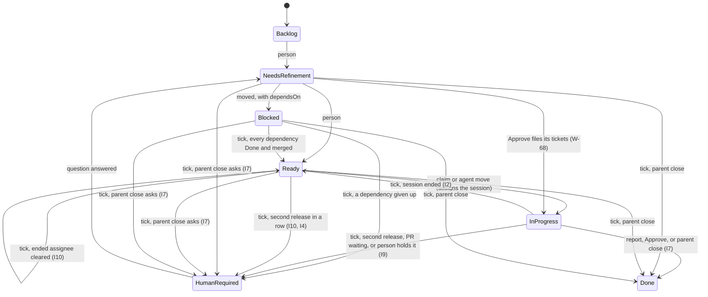

# Intent: Work lifecycle — Blocked items with dependencies, real tickets, nobody but a session In progress

**Status:** Draft

**Work item:** W-116 (W-68 folded in)

**Supersedes:** W-70 I1, its first bullet ("A person who moves an unassigned item into In progress becomes its assignee"), and its fourth bullet ("`create` into In progress follows the same rule") where the creator is a person. Replaced by I9 below, which refuses both. `intent/2026-11-18-w70-in-progress-owner.md`.

**Supersedes:** W-70 I1, its owner definition and its finding F3. W-70 counts only open tickets as an owner ("no assignee and no open tickets"), so a parent's last ticket closing leaves it unowned until the next tick. Here an item is owned by its tickets whatever their status ("has tickets", I1 below), so that write no longer leaves it unowned and F3 does not arise. W-70 I3's owner "open tickets" is unchanged: a parent whose tickets are all closed is owned under I1 but is never released; it follows its tickets under I7.

**Supersedes:** W-70 I2, for a parent only. Before W-70 I2 releases an In progress item whose session ended, the tick checks I7. A parent with tickets, all of them closed, follows them under I7 and is not released (I2 below). The rest of W-70 I2 stands.

**Supersedes:** W-70 I3, the owner "a person" only. No person can hold In progress any more (I9), so the clause has nothing to protect. The other three owners stay.

**Supersedes:** W-70 I4, the clause "every release after the first goes to Human required" only. The stay release of a parent its open tickets own does not ask (I4 below). The bound on claims stands.

**Supersedes:** W-70 I5, whole-board idempotence. It now holds per item (I5 below): a closing parent can be a ticket of a grandparent, which follows on the next tick.

**Supersedes:** W-70 I6, generalised. Request changes still clears the assignee, and now every move into Ready for work does (I6 below).

**Supersedes:** W-70 I7, in full: what a ticket is (`createdFrom` is no longer read), and which statuses a parent closes from. Replaced by I7 and I14 below.

**Supersedes:** W-70 I8 revision 2 (`intent/2026-11-21-w70-i8-waiting-work-r2.md`), in part. Approve of a session review never closes an item that still has open tickets. That replaces revision 2's constraint "the decision is read from the item alone": it is read from the item and from the items whose `ticketOf` names it, so `waitsOnSessionReview()` takes the board. The rest of revision 2 stands.

Owner request, 2026-11-21: "Use Crosscheck to independently verify your stall fix proposals, then hand all the verified proposals to background agents." This spec is the verified proposal for the lifecycle half of that: the stalls that come from how an item moves, rather than from the routines that move it.

## Problem statement

The board has five lifecycle stalls, each seen on it this week.

1. **Items wait on other items, and nothing says so.** The Chat Graph chain (W-88 then W-87, then the UI tickets W-101 to W-107) and the ambient capture chain sit in Needs refinement with "blocked by W-n" in prose. Nothing can read that prose. So nobody is told when a blocker merges, and the item does not move. A person has to notice, then move it by hand.
2. **A follow-up holds its parent open.** W-70's tickets W-90 and W-91 closed. W-75, a follow-up created from W-70 to record a later idea, kept W-70 In progress, because I7 counts every item created from a parent (`createdFrom`) as its ticket. W-70 was moved to Done by hand. W-22 is held the same way by W-68.
3. **A parent outside In progress never closes.** I7 fires only on an In progress parent. A parent that a person parks in Ready for work, or that waits in Needs refinement while its tickets run, never follows them.
4. **A person in In progress is invisible to every rule.** W-70 I1 makes the person the assignee when they move an unassigned item into In progress. Nothing can tell whether the person is still working on it, so I2 never releases it, and an agent never picks it up.
5. **A Ready item can hold a session that ended.** I6 clears the assignee on Request changes only. Any other move into Ready for work keeps whoever was assigned. When that session ends, routines that pick up unassigned work (`unassignedOnly`) skip the item for good.

W-68 adds a sixth. Approving a spec does not file its tickets. The approving person, or a briefing session, files them by hand from the spec's Tickets list, and forgets the order they depend on.

## Proposed outcome

1. An item that waits on other items is in its own lane, Blocked. It lists what it waits on, and it moves to Ready for work by itself once all of those are Done and merged. If one of them is given up, it asks a person.
2. Only an explicit marker makes an item a ticket. A follow-up never holds its parent. A parent closes when its tickets do, from any open lane except Backlog and Human required. The board shows each parent with its tickets' progress.
3. Only a session, or a parent's own open tickets, holds In progress. A person's work on an item is visible through Human required or a linked session, never as an In progress card nobody can release.
4. A Ready for work item never stays held by a session that has ended.
5. Approving a spec files its tickets in one write, in dependency order, and the spec's item then waits on them.

## Affected users and systems

- People using the Work board: a new Blocked lane, and a parent shown with its tickets. They can no longer hold an item In progress.
- Agents writing items through `canvas_work`: new `dependsOn` and `ticketOf` fields, and new refusals (I9, I13, I15).
- Routines and the routine runner's tick (`src/web/routine-runner.ts`, `src/canvas/routines.ts`): the tick gains the Blocked release, the Ready release, the parent close from every open lane and the I9 migration. Claims skip parents.
- The Reviews page's Approve (`src/reviews/`): the open-ticket guard, `merged`, and spec filing (W-68).
- `work.json` (`src/canvas/work.ts`, `work-store.ts`), which the previous release must still read (Data, Rollback).

## Lifecycle



The diagram draws one edge for several families. A release (I2) goes back to the lane the item entered In progress from (Backlog, Needs refinement, Human required or Ready for work), or to Needs refinement, and the diagram draws it as Ready. W-68 filing moves the parent into In progress from any open lane, and the diagram draws it from Needs refinement. In progress also reaches Human required by the parent close asking (I7). The diagram leaves out moves a person makes by hand, and Not doing and Deleted. Those are unchanged.

## Data

All new keys ride the item's passthrough schema, so the release before this one keeps them unread and unharmed (self-building rule 5). `work.json` gains no new value in `status` and no `version` bump.

| Key | Shape | Meaning |
|---|---|---|
| `todoStatus: "blocked"` | on a stored `status: "todo"` | the new lane, stored as W-48's Todo split stores its three lanes |
| `dependsOn` | `number[]`, unique, at most 20 | item numbers this item waits on |
| `ticketOf` | `number` | the parent this item is a ticket of; always a lower number. Set once: changing or removing it is not part of this spec, and the model refuses a second `SetTicketOf` |
| `merged` | `{ sha?: string, at: string }` | a merge of this item's work is recorded |
| `filed` | `{ spec: string, at: string }` | this item's spec tickets were filed (W-68) |
| `followed` | `true`, or absent | a parent already followed its tickets since one was last open (I7) |

One write may set `dependsOn` and move the item to Blocked together. `merged` is read only on a Done item: on any other item it is decoded as absent, whatever the file says. A write that moves an item out of Done also clears the stored `merged`, as the model's `Mv` does, so an item reopened and finished again without a merge does not release its dependents. The read rule covers the old release, which does not clear it.

`createdFrom` stays. It becomes provenance only: "made while working on W-n". Nothing in the work lifecycle reads it to decide anything. pr-swarm's R-3 attribution still reads it (`src/reviews/swarm-git.ts`, `swarm-model.ts`, `review-work.ts`) and is not changed by this spec.

**Rollback.** The previous release decodes an unknown `todoStatus` with `.catch(undefined)`, so `migrateTodo()` reads a Blocked item (always unassigned) as Needs refinement, which is where those chains wait today. A parent it would have held In progress by `createdFrom` is held, as before. The old release keeps `dependsOn`, `ticketOf`, `merged` and `filed` as unknown keys on every write. Three things do not survive a rollback and a roll forward. `encodeWorkFile()` rewrites every item on every write, so the old release's first write of anything stores the whole Blocked lane as Needs refinement; those items come back there, with `dependsOn` intact, and a person (or the migration step again) moves them back. The old release does not clear `merged` when an item leaves Done, which is why `merged` is ignored on any item that is not Done. And `deleted.from` is `NotDeletedStatusSchema` in the old release, which would drop a delete record naming Blocked and show the item as Not doing; so deleting a Blocked item records `from: "needs-refinement"`, and restoring it lands in Needs refinement. `routines.json` cannot name Blocked (below), so it stays readable too.

## Invariants

Each is testable on its own and each is mirrored by a lemma in `intent/2026-11-21-w116-work-lifecycle.dfy` (named in brackets).

### Kept from W-70, restated over the whole board

- **I1. In progress always has an owner** [`I1_InProgressHasAnOwner`, `I1_AgentMoveAssignsItself`]. An In progress item is held by a session, or has tickets (`ticketOf` points at it). No write breaks this, including a ticket closing: having tickets is not taken away by a ticket's status, so W-70's finding F3 no longer arises. An agent that moves an unowned item into In progress becomes its assignee, as before.
- **I2. An ended session's item is released** [`I2_EndedSessionReleases`]. Unchanged, including F1: a release never closes an item. A parent close is not a release. If an In progress parent's session has ended and all its tickets are closed, the parent follows them under I7 (to Done, or to Human required with a question), and I7 is decided before I2.
- **I3. A live or unknown session is never released** [`I3_LiveOrUnknownIsNeverReleased`], in any lane. Unknown counts as live. W-70 I3's other owners stand unchanged: a run whose task is queued, running or waiting, and open tickets. Runs are outside the model, whose liveness input is a session's only, so the run case is checked by W-70's tests, not by a lemma. That case is a run whose task ended, which W-70 I2 releases even while its session is live.
- **I4. Repeated releases ask** [`I4_ClaimKeepsBound`, `I4_TickKeepsBound`, `I4_ClaimRefusedAfterTwoReleases`, `I4_LaterReleasesAsk`]. The Ready release (I10) counts toward the same `Released:` run. The one release that does not ask is the stay release of a parent whose open tickets own it; a parent is never claimed (I14), so no run can follow it.
- **I5. The release settles each item** [`I5_TickIsSettledPerItem`]. What the tick writes on an item, the next tick leaves alone, if nothing else changed. W-70 stated I5 for the whole board. That no longer holds exactly: a parent that closes can be a ticket of a grandparent, which follows on the next tick. One tick per level.
- **I6. Entering Ready for work clears the assignee** [`I6_EnteringReadyClearsAssignee`, `I6_RequestChangesUnassigns`], unless the same write names a session. Naming the person is refused. Sessions stay linked.
- **I7. A parent follows its tickets** [`I7_ParentFollowsItsTickets`]. A parent is an item some other item's `ticketOf` names. When none of its tickets is open, and nobody live holds it (a person assignee holds it, a live or unknown session holds it, an ended session does not), the tick moves it from Needs refinement, Ready for work, Blocked or In progress to Done (if every ticket is Done; `merged` is set if every ticket's is) or to Human required asking whether it is done. Backlog and Human required are left alone: a person parked it there. The rule fires once each time the tickets all close: the close sets `followed`, and only a tick that sees a ticket open again clears it (no history line). So answering the parent's question, which moves it to Needs refinement, or a person moving it back to Ready for work, is never undone by the next tick [`I7_AnswerIsNotUndone`, `I7_PersonMoveIsNotUndone`, `I7_OpenTicketRearms`]. In progress is the exception: a person cannot put a parent there without an open ticket (I9), so an In progress parent with none always settles, mark or not. A Blocked parent follows its tickets before its own `dependsOn` is checked. Its tickets decide, so it goes to Done, or asks, even while one of its dependencies is unmet.
- **I8. Approve closes work waiting on a session review** [`I8_ApproveClosesWaitingWork`, `I8_TickSignsAsServerOrTheEndedSession`, `I8_TickKeepsWaitingWork`]. Revision 2 stands, with one guard added: an item with an open ticket is never closed by it [`I8_NeverClosesAnOwnedParent`]. The tick writes only as the server or as the ended session it releases. Work that waits on a review keeps waiting, is closed, or asks a person.

### New

- **I9. No person in In progress** [`I9_NoPersonInProgress`, `I9_PersonMoveIntoInProgressRefused`, `I9_TickMigratesAnyBoard`, `I9_TickLeavesNoPersonInProgress`].
  - `create` and `update` refuse a person as the assignee of an In progress item (`INVALID_INPUT`, naming Human required as the lane for work a person is doing).
  - A person's move of an unowned item into In progress is refused. It is not redirected. A person who wants an agent on it moves it to Ready for work, or names a session in the same write. The one exception is W-68 filing. Its write moves the parent into In progress and also files the tickets that own it, and I1 and I9 are checked on the board after that whole write (W-68 below).
  - `report` by a person never leaves an item In progress and unowned.
  - The migration: on its first tick, every In progress item held by the person moves to Human required, keeping the person as assignee, written as the server. Its question: "A person cannot hold In progress any more (W-116). Move it to Ready for work for an agent, or answer to keep it with you."
- **I10. A Ready item never keeps an ended session** [`I10_EndedReadyAssigneeCleared`, `I10_ReadyReleaseNeverMakesWorkWait`, `I8_ReadyReleaseNeverTakesWaitingWork`]. The tick clears a Ready for work item's session assignee once that session has ended. It does not unlink the session. It writes `Released: session S ended without a report` as the server, not as S, so W-70 I8 (which closes work whose newest line is S's own) can never close an item that was only queued. A Ready item holding a session never has a release line, so this release never takes work that waits on a review. It counts toward I4, so the second release in a row asks. "As the server" means as the canvas owner, as every tick write is today; the Ready release writes only its `Released:` line and no `Moved from` line, so `releasesInARowOf()` counts it and does not read it as a person's move. The item keeps its place in Ready for work. Revision 2's case (c) is decided by the line's author, never its text: a test writes a server-authored `Released: session S` line and checks that Approve of S's review leaves the item alone.
- **I11. A Blocked item is released only when its dependencies are Done and merged, and then it is** [`I11_ReleasedOnlyWhenMerged`, `I11_ReleasedWhenMerged`, `I11_DoneAloneIsNotEnough`]. Done alone is not enough. A Done item whose pull request has not merged keeps its dependents waiting. The tick moves the item to the bottom of Ready for work, written as the server, which restarts the I4 count.
- **I12. A dependency given up asks a person** [`I12_GivenUpDependencyAsks`]. Given up means Not doing, Deleted, or Done with no `merged` and no pull request. The item moves to Human required, naming the dependency. "Merged" in I11 and I12 means the `merged` field. Ticket 3 also reads a Done item's existing merge record as merged (Migration). The model reads only the field, so the reading of those records is checked by ticket 3's tests and not by a lemma.
- **I13. Nothing waits on itself** [`I13_CycleRefused`, `I13_NoTicketWaitsOnItsParent`, `I13_TicketDependingOnItsParentRefused`, `SetDepsInv`, `SetTicketOfInv`, `CreateInv`]. The cycle check runs over one graph: an item points at what it depends on and at its own tickets, because a parent waits on its tickets. `create` and `update` refuse a `dependsOn` or a `ticketOf` that would close a loop in it, at any depth. So a ticket can never depend on its parent or grandparent, which would leave both waiting for good. The check runs at write time, so the graph is acyclic on every board (proved as part of the invariant).
- **I14. Tickets are marked, never inferred** [`I14_FollowUpsDoNotHoldTheParent`, `ParentsAreNeverClaimed`]. Only `ticketOf` makes an item a ticket. It is set when the ticket is created or filed, or later by a person or by an agent quoting the person (the migration). A routine never claims an item that has tickets.
- **I15. Blocked holds nobody and no question** [`BlockedIsNeverClaimed`, `AgentCannotUnblock`, part of `Inv`]. Entering Blocked needs a non-empty `dependsOn` and no open question, and clears the assignee. Naming an assignee while Blocked is refused, and so is clearing `dependsOn` unless the same write moves the item out. An agent moves an item from Blocked to Ready for work or In progress only by quoting the person's instruction, as for Backlog. An agent also creates an item into Ready for work, or moves one there from any lane, only while every one of its dependencies is Done and merged, or by quoting the person's instruction (`Create`, `Edit`). A person may. A routine can neither fire on Blocked nor claim from it.

A Blocked item with an open question. Entering Blocked is refused while the item has a question, so the item stays in Needs refinement or Human required until the question is answered, then is moved. If a question arrives some other way (a dependency is given up), the item goes to Human required at once (I12). The tick's "all satisfied but a question is open" branch is therefore unreachable; it goes to Human required anyway, so nothing is ever released past a question.

## W-68: Approve of a spec review files its tickets

On Approve of a session review, before `closeLinkedWork()` runs, the server looks at the merged diff for a new file under `intent/` with a `**Work item:** W-n` line and a fenced block tagged `work-tickets`, of this shape:

```json
[
  { "id": "t1", "title": "…", "description": "…", "dependsOn": [] },
  { "id": "t2", "title": "…", "description": "…", "dependsOn": ["t1"] }
]
```

The example above is fenced as `json` so that this spec's own Tickets block is its only real one. A spec carries exactly one `work-tickets` block; two or more file nothing, and the Approve answer says so.

- `dependsOn` names earlier entries only, so the list is in dependency order. The tickets take the next item numbers in list order. An entry's `id` is local to the block and becomes that number in the filed `dependsOn`.
- Only Approve of a session review files, and so does the resync of that Approve. Approve of a work review does not.
- A parent that is closed (Done, Not doing or Deleted), or already `filed`, files nothing, and the Approve answer says so (the model's `CanFile`).
- One `changeWork()` files every ticket and moves the parent W-n:
  - each ticket gets `ticketOf` and `createdFrom` set to W-n, and is Ready for work if it depends on nothing, Blocked otherwise;
  - the parent goes to In progress, unassigned (its tickets own it, I1), its question is cleared, and `filed` is set.
- Each ticket's `requestId` is a uuidv5 of the spec path and the ticket id, so a retry files nothing twice. A parent with `filed` set is never filed again [`W68_FilingHappensOnce`].
- Filing runs before `closeLinkedWork()`, so that same Approve never closes the parent [`W68_FilingKeepsTheParentOpen`]: the filing write is the parent's newest line and is the person's, so I8 does not match it, and the open-ticket guard [`I8_NeverClosesAnOwnedParent`] would refuse it anyway. The resync after a crash between merge and write files too.
- The write is authored as the approving person. I1 and I9 are checked on the board after the whole write, which already holds the tickets that own the parent.
- The parent is the first `W-n` on the `**Work item:**` line.
- The block is checked against `create`'s limits before the write (title and description lengths, at most 20 `dependsOn`, the item cap). Any violation files nothing, and the Approve answer says why. The filing write is all or nothing.
- A block that does not parse, or a missing W-n, files nothing. The Approve still merges, and its answer says why nothing was filed.

Telling a spec review from a branch review is out of scope: any merged intent file with both markers files.

A filed ticket can depend only on other tickets of the same spec. A dependency on an existing item (the W-78 UI tickets on W-88, say) is added after filing with `update`, which runs the cycle check.

## Where "Nothing moves an item by itself" changes

Each of these says it today, with W-70's exceptions. Each gains the new ones (Blocked release, given-up ask, the person migration, the Ready release, parent close from any open lane, and spec filing):

1. `CLAUDE.md`, the **Canvas work** bullet (line 119).
2. `docs/subsystem-rules.md`, **Canvas work** (line 296).
3. `docs/architecture-invariants.md`, **Canvas work** ("Nothing on the server applies the run-end rule", in the section from line 2084) and the **Canvas routines** bullet (line 2152, "The owner release (W-70) runs first").
4. `src/mcp-server.ts:230`, the `canvas_work` tool description an agent reads.
5. `src/canvas/work.ts`, the `@fileoverview` (line 14).
6. The `canvas_capabilities` document. It is at its 60 KB cap, so the ticket that edits it must cut an equal amount, not raise the cap.

The same change must also update every other statement of a rule this spec changes, not only the "Nothing moves" sentences:

7. `docs/architecture-invariants.md`, **In progress always has an owner (W-70)**. It defines the owner as "the items created from it that are not closed" and says a ticket closing leaves the parent unowned. Both change under I1 and I14. The paragraph also covers the person as an assignee (I9), I3's owner list, I4's count, and I7's source lanes, `followed` mark and `ticketOf`.
8. `docs/architecture-invariants.md`, **The status contract (W-48)**. It gains the Blocked lane and its entry rules (I15), and Request changes clearing the assignee generalises to every move into Ready for work (I6).
9. `CLAUDE.md` and `docs/subsystem-rules.md`, **Canvas work**: the statements that a parent closes when its tickets do, and which items Approve moves (I7, I8's open-ticket guard, I14).
10. The header comments of `src/web/routine-runner.ts` and `src/canvas/routines.ts`, which describe the tick's release.
11. `packages/canvas/src/work-model.ts` and `work-view.ts`, which read `createdFrom` to show a parent and its children. Ticket 5 moves them to `ticketOf`.
12. `docs/api-reference.md`, the `POST /api/v1/reviews/:id/approve` row, which gains filing and the open-ticket guard.
13. `src/canvas/work-store.ts`, the `@fileoverview`, which lists the lanes a stored Todo item decodes into. Blocked is added.
14. `docs/architecture-invariants.md`, **Deleted (W-22)**: a deleted Blocked item records `from: "needs-refinement"`, and the "items created from it" wording changes under I14.
15. `src/web/CLAUDE.md`, **Canvas work**, which describes the lanes and how the view groups parents.
16. `packages/canvas/src/work-view.ts`, the `@fileoverview` ("seven lanes").

## Migration

Approving this spec approves these one-off writes, quoting this section as the instruction. They run as one step, at a set point, so no ticket ships against a board it would break.

**After ticket 1 deploys and before ticket 2 does** (ticket 2 switches the parent rule from `createdFrom` to `ticketOf`, so W-76, W-89 and W-108 would otherwise read as unowned):

- `ticketOf` for the real tickets on the board today: W-66 and W-67 → W-22; W-90 and W-91 → W-70; W-80 to W-88 (not W-84, deleted) → W-76; W-93 to W-99 → W-89; W-109 to W-115 → W-108. W-101 to W-107 → W-78 only after a check that W-78's spec lists them.
- Not tickets, so not marked: W-68, W-75, W-77, W-78 (follow-ups).
- Tickets filed by hand after ticket 1 deploys, this spec's own six among them, are created with `ticketOf` naming their parent (W-116 for these). W-68 filing ships last, so until then each filing sets it by hand. Otherwise their parents read as unowned once ticket 2 lands.
- Each write goes through `changeWork()`, one item at a time, with the same checks as `update`. A write that I13 or I15 refuses is skipped and listed in the step's report. The report also lists, for each parent, how its spec's Tickets list was mapped to item numbers.
- `dependsOn` for each set of tickets above, read from its parent spec's Tickets list. Every open item that waits on one is moved from Needs refinement to Blocked by the same write. An item with an open question cannot enter Blocked: it keeps its `dependsOn`, stays where it is, and is listed in the step's report so its question is answered first.

**No backfill for `merged`.** Ticket 3 reads a Done item as merged when it has `merged`, or when its merge is already on record: a `Done: review <id> merged <sha>` history line, or a work review with a `mergedSha`. So no window opens in which a finished dependency reads as given up. A Done item with neither asks a person (I12), once per dependent.
- I9's migration needs no ticket: the first tick makes it. On 2026-11-21 there is no In progress item held by the person and no Ready item with an assignee, so neither the I9 nor the I10 migration moves anything today.

## Constraints

- Every write the tick makes goes through `changeWork()` with `expectedRevision`, one item per write, as W-70's release does. A stale decision waits a tick.
- The tick reads `work.json` once per pass and decides every item from that snapshot. `release()` returns early today when no item is In progress; that gate goes, or the Blocked release, the Ready release and parent closing never run on such a board.
- Blocked is not a routine status: `RoutineStatusSchema` stays `NotDeletedStatusSchema` minus Blocked, so `routines.json` stays readable by the previous release.
- `dueWorkItem()` and `claim()` skip an item with tickets.
- `applyRelease()` today puts a released item at the top of Ready for work (`place(…, 1)`, with a `Moved to position 1` line). The Ready release keeps the item's place and writes only its `Released:` line (I10), and the Blocked release goes to the bottom (I11). So tickets 3 and 4 change that placement for their releases, and their tests assert the position.
- No new SSE event. The board learns of every change from `canvas:changed` with `work: true`.

## Non-goals

- Telling spec reviews from branch reviews (W-68's second half).
- A Done item whose pull request merged outside a review (by hand, or by a routine) is caught by the Reviews sync, which sets `merged` when the pull request's head is reachable from the default branch (ticket 3). One closed without merging is not handled here.
- A Done item whose pull request was closed without merging. Its dependents wait, and a person sees why in the dependency list. A closed-unmerged review counting as given up is a follow-up.
- Reading "blocked by W-n" out of prose. Dependencies are typed in, or filed.
- Unlinking ended sessions, or writing history lines on items for sessions that ended. Both would break W-70 I8 revision 2 (its lemma `I8_AnyOtherWriteKeepsItOpen`). Showing an ended session as ended, when the item is read, is fine and is ticket 5's.

## How this was checked

`intent/2026-11-21-w116-work-lifecycle.dfy` is a multi-item model: the board is a map of items, and the tick decides every item from one snapshot, as `RoutineRunner.release()` does. The two W-70 models are single-item and cannot say "every dependency is Done" or "no ticket is open", so they stay as they are. This model restates the W-70 invariants it keeps and proves them again over the board.

Dafny 4 verifies **189** items with 0 errors, with no `assume` and no axiom. The proofs cover:

- **The invariant** (`Inv`): ids below `next`, dependencies name existing items, the graph of dependencies and ticket links is acyclic, tickets point at earlier items, In progress is held by a session or owned by tickets, no person In progress or Ready, Blocked holds nobody and no question, a release line implies no assignee and the session as author, a session assignee is linked, `cameFrom` is never In progress, and `merged` only on Done. Every write path keeps it (`CreateInv`, `EditInv`, `SetDepsInv`, `SetTicketOfInv`, `ReportInv`, `ClaimInv`, `RequestChangesInv`, `ApproveWorkInv`, `AnswerInv`, `CommentInv`, `SessionApproveInv` including filing), and so does the tick (`TickInv`).
- **Acyclicity** by a least-predicate induction on paths (`ReachUpdate`, `UpdateKeepsAcyclic`, `FreshKeepsAcyclic`, `AddEdgeKeepsAcyclic`), with one lemma per shape of write (`GraphAddFresh`, `GraphSetDeps`, `GraphSetTicketOf`). Filing adds tickets that depend only on earlier tickets, and a path from a new ticket never leaves the new tickets (`ReachStaysAbove`, `AddTicketsOk`).
- **The lemmas named against each invariant above**, plus `TickEdges`: the tick never enters Blocked or In progress, never enters Not doing or Deleted, enters Done only for a parent with no open ticket, and only ever keeps an assignee or clears it.

The model and the review found four things that changed this spec while it was written:

- The stay release (a parent's session ends while its tickets are open) counts as a release but does not ask, because the parent stays In progress, owned by its tickets. W-70 I4's "every later release asks" is false for it. That is safe because a parent is never claimed (I14), and I4 now says so.
- The independent review found that, with parents closing from Needs refinement, the rule looped: the tick asks, the person answers, the next tick asks again. The `followed` mark makes it fire once per closing, and `I7_AnswerIsNotUndone` proves the answer stands. It also found that a ticket could depend on its own parent and deadlock both. The cycle check now runs over ticket links too, and `I13_NoTicketWaitsOnItsParent` proves no ticket can.
- The invariant first allowed a Blocked item to carry a session's release line. No path produces one, but without saying so the I8 lemma failed: the tick releasing such an item would have dropped a review's waiting work. Blocked now requires no release line, as part of the invariant.

**Mutation check.** Each rule was removed or weakened in turn, on a copy, and the model re-verified.

| # | Rule removed or weakened | Lemmas that failed |
|---|---|---|
| M1 | Tickets inferred from `createdFrom`, as before W-116 | `EditInv`, `TickItemOk`, `I2_EndedSessionReleases`, `NotOwnTicket`, `I14_FollowUpsDoNotHoldTheParent` |
| M2 | A dependency counts as satisfied when Done, merged or not | `I11_ReleasedWhenMerged`, `I11_DoneAloneIsNotEnough` |
| M3 | No cycle check when dependencies are set | `SetDepsInv`, `I13_CycleRefused`, `I13_TicketDependingOnItsParentRefused` |
| M4 | A person may hold an In progress item | `EditInv`, `I9_PersonMoveIntoInProgressRefused` |
| M5 | The Ready release written as the ended session, with its release line | `I10_EndedReadyAssigneeCleared`, `I10_ReadyReleaseNeverMakesWorkWait` |
| M6 | A parent closes only from In progress, as in W-70 | `I7_ParentFollowsItsTickets` |
| M7 | Entering Ready for work keeps the assignee | `EditInv`, `I6_EnteringReadyClearsAssignee` |
| M8 | Approve ignores open tickets (I8 revision 2 as written) | `I8_NeverClosesAnOwnedParent`, `I8_TickKeepsWaitingWork` |
| M9 | An unknown session counts as ended | `I3_LiveOrUnknownIsNeverReleased`, `I8_TickSignsAsServerOrTheEndedSession` |
| M10 | Claim accepts an item that has tickets | `ParentsAreNeverClaimed` |
| M11 | Claim may fire on Blocked | none (see below) |
| M12 | A given-up dependency is ignored | `I12_GivenUpDependencyAsks` |
| M13 | The cycle check sees dependencies only, not ticket links | `GraphAddFresh`, `GraphSetDeps`, `GraphSetTicketOf`, `I13_NoTicketWaitsOnItsParent`, `I13_TicketDependingOnItsParentRefused` |
| M14 | The parent rule fires every tick, not once per closing | `I7_AnswerIsNotUndone`, `I7_PersonMoveIsNotUndone` |

M11 survives because the rule is redundant in the model: a claim is an agent's move out of Blocked, which I15 already refuses without the person's words. Keeping Blocked out of the routine statuses is still required, for a different reason the model does not cover: `routines.json` must stay readable by the previous release. Two earlier runs also found a vacuous lemma: with M6 applied, `I7_ParentFollowsItsTickets` still passed, because its precondition used the predicate the mutant narrowed. It now states its precondition directly, and M6 fails it.

The model leaves out history text (only the newest line's author and whether it is a release line), ready-queue order, revisions and `expectedRevision` races, requested changes, comment text, the 50-line history cap, and the parse of the `work-tickets` block (a filing is given as already parsed). It also leaves out the text of a question. The I9 migration's question is stated in the prose only: the model moves the item to Human required without setting `needs`, and `Inv` does not require Human required to carry a question. Liveness is a function the tick is handed, as `sessionState` is. It does not model routines beyond `claim()`.

## Audit

`crosscheck:audit-invariant-consistency` was run over `docs/invariants/*.md` and this spec's I1 to I15, against the two W-70 specs this one partly supersedes. `docs/invariants/` holds only respawn and deploy-lease promises (RL-1 to RL-6). They share the word "release" (a lease) with this spec, but neither constrains the other. The nine findings are all between this spec and W-70, or inside this spec. All nine were accepted and fixed above:

| # | Finding | Fix |
|---|---|---|
| F1 | I4's stay release weakens W-70 I4 with no Supersedes line | Supersedes line for that clause |
| F2 | I5 per item weakens W-70 I5 | Supersedes line for I5 |
| F3 | The I8 open-ticket guard reads other items; revision 2 says "read from the item alone" | the Supersedes line names that constraint; `waitsOnSessionReview()` takes the board |
| F4 | The Ready release writes the same `Released: session S` text as I2, by another author | I10 says case (c) is decided by author, and ticket 4 tests it |
| F5 | Filing is a person's write moving the parent into In progress unassigned, which I9 refuses unless its tickets already own it | I1 and I9 are checked on the board after the whole write |
| F6 | The old release leaves `merged` on an item it moves out of Done | `merged` is read only on Done |
| F7 | "Nothing is lost" on rollback was too strong: the Blocked lane is | Rollback says what survives |
| F8 | The diagram read as if setting `dependsOn` moves the item | edge relabelled |
| F9 | I10 did not say where the item sits in Ready | it keeps its place |

The audit is a search, and finding nothing more does not show there is nothing more.

## Independent review

One fresh agent was given the goal and the files (this spec, the model, the two W-70 specs, `docs/self-building.md` and the code it changes), and none of the author's conclusions. It verified the model itself (163 items at the time) and returned **rework**, bounded to two rules, the ticket order and the rollback wording. Every finding was taken:

| # | Severity | Finding | Resolution |
|---|---|---|---|
| 1 | High | Parents closing from Needs refinement loop: the tick asks, the answer moves the parent to Needs refinement, the tick asks again; a person's move of a settled parent is undone | `followed` mark, I7 fires once per closing; `I7_AnswerIsNotUndone`, `I7_PersonMoveIsNotUndone`, `I7_OpenTicketRearms`; mutant M14 |
| 2 | High | A ticket depending on its parent deadlocks both; the cycle check saw only `dependsOn` | the graph includes ticket links, checked on `dependsOn` and `ticketOf` writes and on create; `I13_NoTicketWaitsOnItsParent`; mutant M13 |
| 3 | High | Ticket 2 reads `ticketOf` before anything sets it, so today's parents read as unowned | ticket 1 writes `ticketOf`, the migration runs between tickets 1 and 2, ticket 2 depends on ticket 1 |
| 4 | Medium | `release()` returns early with nothing In progress | the gate goes (Constraints, ticket 3) |
| 5 | Medium | `merged` set only by review paths; a pull request merged otherwise leaves dependents waiting silently | the Reviews sync sets it when the head is reachable from the default branch (ticket 3); existing merge records count, so no backfill window |
| 6 | Medium | Rollback wording: every write re-encodes every item; `deleted.from` cannot name Blocked in the old schema | Rollback rewritten; a deleted Blocked item records `from: "needs-refinement"` |
| 7 | Medium | Placeholders left in the spec | filled |
| 8 | Low | The model's Server author is the canvas owner in the code, whose `Moved from` line resets the I4 count | I10 says the Ready release writes only its `Released:` line |
| 9 | Low | Blocked is invisible until ticket 5 | ticket 1 draws a minimal lane |
| 10 | Low | The migration cannot move an item with an open question into Blocked | such items stay, keep `dependsOn`, and are listed |
| 11 | Low | Filed tickets cannot depend on existing items | named as a limit of the format; added afterwards with `update` |

The reviewer also confirmed that no lemma was vacuous, that the `todoStatus` rollback path reads as Needs refinement, and that `routines.json` stays readable. After the fixes the model was verified again and the mutation check re-run on the final file; the reviewer has not seen the fixed version.

On 2026-11-23 the pr-swarm review of this branch (run bf3e007ef3875747) re-ran `dafny verify` on the final file independently: 189 verified, 0 errors, no `assume` and no axiom. It did not re-run the mutation table.

## Open questions

The design decisions still open are the Decisions for Harry below.

## Decisions for Harry

1. **Done without a merge and without a pull request asks, rather than waits.** The alternative is to count it as satisfied, which would release dependents of work that never reached master.
2. **Parents close from Ready for work, Needs refinement and Blocked too, not only In progress.** Backlog and Human required are left alone because a person parked the item there. Outside In progress it fires once per closing (the `followed` mark), so a person's answer or move stands.
3. **A person's move into In progress is refused, not redirected to Human required.** A redirect would put a card where the person did not drop it.
4. **The `work-tickets` block format** above, for W-68 filing.
5. **The Ready release counts toward I4,** so an item whose assigned session keeps ending asks on the second time.
6. **The UI for the Blocked lane and for a parent's progress** is ticket 5, designed with impeccable and a prototype before build. Where Blocked sits in the lane order is part of that.

## Tickets

<details>
<summary>Six tickets, in order. Each is reviewable alone.</summary>

```work-tickets
[
  { "id": "t1", "title": "Work lifecycle 1: the Blocked lane, dependsOn and the cycle check",
    "description": "Stored as todo + todoStatus 'blocked'. dependsOn and ticketOf on create and update (ticketOf stored but not yet read), with I13's cycle check over both and I15's entry and assignee rules. The Backlog instruction rule extends to Blocked. RoutineStatusSchema excludes Blocked; deleting a Blocked item records from needs-refinement. A minimal Blocked lane on the board, listing each item's dependencies as text. Tests marked // Invariant I13, I15. Then the migration. Spec intent/2026-11-21-w116-work-lifecycle.md.",
    "dependsOn": [] },
  { "id": "t2", "title": "Work lifecycle 2: ticketOf, the parent rule from any open lane, and no claim on parents",
    "description": "Starts only once the migration is on the board. ownerOf and openTickets read ticketOf, never createdFrom. I7 from NR, Ready, Blocked and In progress, once per closing (the followed mark). claim() and dueWorkItem skip items with tickets. The stay release. Tests marked // Invariant I7, I14, I4.",
    "dependsOn": ["t1"] },
  { "id": "t3", "title": "Work lifecycle 3: merged, and the tick's dependency release",
    "description": "merged set by approveWork, closeLinkedWork, the resync, the parent close, and the Reviews sync when a Done item's pull request head is reachable from the default branch; ignored on any item not Done. release() loses its 'nothing In progress' early return. The tick moves Blocked to Ready (all Done and merged) or Human required (one given up). A Done item with a Done: review ... merged line or a merged work review counts as merged. Tests marked // Invariant I11, I12.",
    "dependsOn": ["t1", "t2"] },
  { "id": "t4", "title": "Work lifecycle 4: no person In progress, and Ready clears its assignee",
    "description": "I9 refusals on create, update and report, and the tick's migration. I6 generalised to every move into Ready. I10's Ready release, written as the server. I8's open-ticket guard, with waitsOnSessionReview taking the board, and a test that a server-written Released: session S line never matches case (c). Every 'Nothing moves an item by itself' place listed in the spec. Tests marked // Invariant I6, I8, I9, I10.",
    "dependsOn": ["t2"] },
  { "id": "t5", "title": "Work lifecycle 5: the board shows Blocked, dependencies and parent progress",
    "description": "Design with impeccable and a prototype first. The Blocked lane, an item's dependencies and what each waits on, a parent's tickets done out of total, ended sessions shown as ended at read time.",
    "dependsOn": ["t1", "t2"] },
  { "id": "t6", "title": "Work lifecycle 6: Approve of a spec files its tickets (W-68)",
    "description": "The work-tickets block, filed in one changeWork before closeLinkedWork, uuidv5 requestIds, filed marker. I1 and I9 checked on the board after the whole write. Tests marked // Invariant W68.",
    "dependsOn": ["t3", "t4"] }
]
```

</details>
